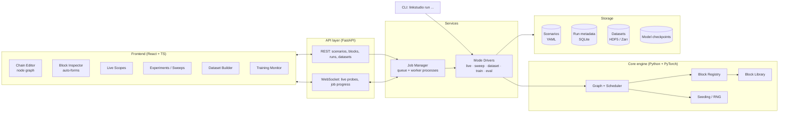

# LinkStudio — System Architecture (v0.1, draft)

> **Status (v0.4):** PHY engine with 86 blocks and a library of 38 scenarios (wireless, copper/SerDes/DSL, optical IM/DD and
> coherent, synchronization, LDPC/polar, MIMO),
> Live / Simulate / Sweep modes in a React UI served by FastAPI. Dataset and ML modes are
> postponed. Implementation details: [ENGINE.md](ENGINE.md), user guide: [GUI.md](GUI.md).

> Working name: **LinkStudio**. A configurable communication-chain simulator, dataset factory and ML training sandbox,
> with a modern web UI.

---

## 1. Goals

| # | Goal | Consequence for the design |
|---|------|----------------------------|
| G1 | Build any TX → channel → RX chain with many degrees of freedom | Block/graph engine with typed ports and schema-described parameters |
| G2 | See what happens *live* (constellations, spectra, eye diagrams, BER) | Streaming execution + probe blocks + WebSocket transport |
| G3 | Run rigorous Monte-Carlo experiments (BER/BLER vs SNR, sweeps) | Headless batch engine, job manager, stop criteria, result store |
| G4 | Generate reproducible ML datasets from any point of the chain | Dataset writer with labels, seeds, manifest, standard formats |
| G5 | Train ML models *inside* the chain (learned demappers, autoencoders, …) | Differentiable engine (PyTorch), ML blocks, training loop |
| G6 | Compare learned vs classical blocks fairly | Shared scenarios + evaluation mode on identical seeds |
| G7 | Learn & extend easily | Plugin-style block registry, clear layering, tests vs theory |

**Non-goals (for now):** multi-user cloud deployment, sample-accurate real-time streaming at RF rates, full 3GPP compliance.

---

## 2. Core principles

1. **One engine, many modes.** Every mode (live, sweep, dataset, training, eval) is just a different *driver* on top of
   the same graph executor. No duplicated DSP code.
2. **Everything is a scenario.** A chain + its parameters + seeds is serialized to a single YAML/JSON file. The UI edits
   scenarios; the CLI runs them. If it ran once, it can run again identically.
3. **Schema-first.** Block parameters are Pydantic models → JSON Schema → the UI auto-generates forms. Add a block in
   Python and it appears in the UI with no frontend work.
4. **Batch-first & vectorized.** Signals are tensors `(batch, streams, samples)`; frames are processed in batches, never
   sample-by-sample in Python.
5. **Differentiable by default.** The engine runs on PyTorch (CPU or GPU). Classical blocks are written with torch ops,
   so gradients flow end-to-end whenever a block is differentiable.
6. **Local-first.** Runs on your PC: a Python backend + a browser UI. The same backend can later run on a GPU server.

---

## 3. High-level architecture



### Layers (strict dependency direction: top depends on bottom, never the reverse)

| Layer | Responsibility | Tech |
|-------|----------------|------|
| **Frontend** | Editing, visualization, job control | React, TypeScript, Vite |
| **API** | HTTP/WS contract, validation, serialization | FastAPI, Pydantic v2, uvicorn |
| **Services** | Job lifecycle, mode drivers, persistence | asyncio, `multiprocessing`/process pool |
| **Core** | Graph, blocks, signals, RNG — pure library, no web code | Python 3.12, PyTorch, NumPy/SciPy |
| **Storage** | Scenarios, results, datasets, checkpoints | YAML, SQLite (SQLModel), HDF5 (h5py) / Zarr |

The **core is usable on its own** (`import linkstudio`) — from notebooks, scripts, tests, or the CLI.

---

## 4. Core engine

### 4.1 Signal model

```python
@dataclass
class Signal:
    data: torch.Tensor        # complex64, shape (B, S, N)  B=batch, S=streams/antennas, N=samples
    fs: float                 # sample rate [Hz]
    meta: dict                # e.g. sps, carrier, frame boundaries, OFDM grid info
```

Other port types: `Bits` (uint8/bool `(B, S, K)`), `Symbols` (complex, symbol-rate), `LLR` (float), `Grid`
(OFDM resource grid `(B, S, n_sym, n_sc)`), `Channel` (CSI / taps), `Scalar` (metrics). Port types are checked when
connecting blocks — both in the UI and in the backend.

### 4.2 Block contract

```python
class Block(nn.Module):
    name: ClassVar[str]               # "qam_mapper"
    category: ClassVar[str]           # "modulation"
    Params: ClassVar[type[BaseModel]] # Pydantic model → JSON Schema → UI form
    inputs:  ClassVar[dict[str, PortType]]
    outputs: ClassVar[dict[str, PortType]]
    differentiable: ClassVar[bool] = True
    trainable: ClassVar[bool] = False

    def __init__(self, params: Params, ctx: RunContext): ...
    def forward(self, **inputs) -> dict[str, Any]: ...
    def reset(self) -> None: ...      # clear internal state (filters, PLLs, ...)
```

- Blocks subclass `torch.nn.Module` → trainable blocks get parameters, `.to(device)`, checkpoints for free.
- Registered with a decorator `@register_block`; third-party/user blocks are discovered from a `plugins/` folder.
- Parameters can be **static** (rebuild block on change) or **live-tunable** (changed in place during live mode,
  e.g. SNR, CFO).

### 4.3 Graph & scheduler

- A scenario graph is a **DAG** of block instances + typed edges.
- Execution: topological order, one call per batch of frames ("frame-based"). Branches are allowed (e.g. one TX feeding
  two receivers to compare a classical vs a neural demapper side by side).
- Feedback (e.g. decision-directed loops) lives *inside* a block, not as graph cycles — keeps the scheduler simple and
  differentiable.
- **Probes** are tap blocks attachable to any edge; they don't alter the signal and publish data to the active driver
  (scope, metric accumulator, dataset writer).
- **Ground truth propagation:** source bits, transmitted symbols, channel realizations etc. travel in a side
  `RunContext.truth` dict so any downstream metric/label block can read them.

### 4.4 Reproducibility

- Each run has a master seed → per-block, per-batch seeds derived deterministically (`hash(master, block_id, batch_idx)`).
- Each run records: scenario hash, code version (git SHA), package versions, device. Stored in the run manifest.

### 4.5 Block library (planned, grows over milestones)

| Category | Blocks |
|----------|--------|
| **Sources** | random bits, PRBS, file/text/image source, multi-class signal generator |
| **Coding** | CRC, scrambler, interleaver, Hamming, convolutional + Viterbi, LDPC (BP / min-sum), polar (SC/SCL), repetition |
| **Mapping** | BPSK/QPSK/M-PSK/M-QAM/APSK (Gray), custom constellation, soft demapper (exact/max-log LLR) |
| **Waveform** | upsampling, pulse shaping (RRC/RC/Gaussian), matched filter, OFDM mod/demod (CP, pilots), SC-FDMA, FSK, GFSK |
| **Channel** | AWGN (Eb/N0, Es/N0, SNR), Rayleigh/Rician flat fading, TDL multipath (EPA/EVA/ETU-like), Doppler (Jakes), CFO, phase noise, timing offset, IQ imbalance, PA nonlinearity (Rapp, Saleh), quantization/ADC, interference |
| **Receiver** | timing recovery (Gardner, M&M), carrier recovery (Costas, PLL), frame sync, channel estimation (LS, MMSE), equalizers (ZF, MMSE, LMS, RLS, DFE), MIMO detection (ZF, MMSE, ML, sphere) |
| **MIMO** | spatial multiplexing, Alamouti, precoding |
| **ML** | MLP/CNN/Transformer demapper, neural equalizer, learned constellation (autoencoder TX), neural receiver, neural BP decoder, modulation classifier |
| **Metrics/Probes** | BER, SER, BLER, EVM, MSE, MI/GMI, throughput, PAPR, spectrum (PSD), constellation, eye diagram, time/IQ scope |

---

## 5. Modes of operation

All modes take a **Scenario** and a **Mode config**; they differ only in how they drive the graph and where outputs go.

### 5.1 Interactive (Live) mode
*"Play with the chain."*
- Runs the graph continuously in small batches (~10–30 updates/s).
- Live-tunable params are changed from the UI without restarting.
- Probes stream decimated data to the UI over WebSocket (binary `Float32Array` frames).
- Running metrics (BER, EVM) with sliding windows.

### 5.2 Sweep / Monte-Carlo mode
*"Get a curve I can trust."*
- Sweep over one or more parameters (grid, list, or random), e.g. `Eb/N0 ∈ [0..12] dB` × `modulation ∈ {QPSK,16QAM}`.
- Per-point stop criteria: `min_errors` (e.g. 100 bit errors), `max_bits`, `max_time`, confidence interval.
- Parallel execution over sweep points (process pool, or batched on GPU).
- Overlay theoretical curves (e.g. exact AWGN BER for M-QAM) for validation.
- Results → SQLite + CSV/Parquet export; plots in the UI.

### 5.3 Dataset generation mode
*"Build data to train on."*
- Choose **taps** (which ports to save: e.g. RX IQ samples) and **labels** (e.g. transmitted bits, modulation class,
  SNR, channel taps, CFO).
- Parameters drawn from **distributions** per sample: `snr_db ~ U(-5, 20)`, `modulation ~ Cat([...])`,
  `channel ~ Cat([AWGN, Rayleigh, TDL-A])`.
- Output: HDF5 (or Zarr) chunked datasets + `manifest.json` (scenario, distributions, seeds, shapes, splits).
- Train/val/test split generated with disjoint seeds.
- Ships with a ready `LinkStudioDataset(torch.utils.data.Dataset)` loader.
- Also: on-the-fly generation (infinite dataset) for training without storing to disk.

### 5.4 Training mode
*"Optimize the communication system."* Two flavours:
1. **End-to-end (in-graph):** some blocks are trainable; loss is computed from graph outputs (BCE on bits/LLRs, CE on
   symbols, MSE, negative MI). Gradients flow through differentiable channel blocks. Example: autoencoder TX+RX over
   AWGN/fading, neural demapper after a fixed classical TX.
2. **Offline (dataset-based):** train a model on a dataset produced by 5.3 (e.g. modulation classifier).

Features: optimizer/scheduler config, SNR curriculum, checkpoints, early stopping, live loss/metric curves in the UI,
optional MLflow/TensorBoard logging. Trained models become blocks that can be dropped back into any scenario.

### 5.5 Evaluation / Benchmark mode
*"Is the ML actually better?"*
- Runs N variants of a scenario (e.g. classical LMMSE receiver vs neural receiver) on **identical seeds** across a
  sweep.
- Produces comparison tables & curves (BER/BLER vs SNR, complexity: params, FLOPs, latency).

### 5.6 (Future) Hardware-in-the-loop
- SDR source/sink blocks (PlutoSDR / RTL-SDR via SoapySDR) replacing the channel with the real air interface.
- Uses the same scenario; only the channel subgraph is swapped.

### Mode → engine summary

| Mode | Batch size | Duration | Grad | Output |
|------|-----------|----------|------|--------|
| Live | small | until stopped | off | WebSocket streams |
| Sweep | large | stop criteria | off | result tables |
| Dataset | large | N samples | off | HDF5/Zarr + manifest |
| Training | medium | epochs/steps | **on** | checkpoints + logs |
| Eval | large | stop criteria | off | comparison report |

---

## 6. Scenario file (example)

```yaml
version: 1
name: qpsk-rayleigh-mmse
seed: 1234
device: cpu
blocks:
  src:   { type: random_bits,  params: { bits_per_frame: 1024 } }
  enc:   { type: conv_encoder, params: { rate: "1/2", constraint_length: 7 } }
  map:   { type: qam_mapper,   params: { order: 4, gray: true } }
  pulse: { type: rrc_filter,   params: { rolloff: 0.25, sps: 8, span: 10 } }
  chan:  { type: rayleigh,     params: { doppler_hz: 50 } }
  awgn:  { type: awgn,         params: { ebn0_db: 8 }, live: [ebn0_db] }
  mf:    { type: rrc_filter,   params: { rolloff: 0.25, sps: 8, span: 10, matched: true } }
  eq:    { type: mmse_equalizer }
  demap: { type: soft_demapper, params: { order: 4, method: maxlog } }
  dec:   { type: viterbi_decoder, params: { rate: "1/2", constraint_length: 7 } }
  ber:   { type: ber_meter }
edges:
  - src.bits -> enc.bits
  - enc.bits -> map.bits
  - map.symbols -> pulse.in
  - pulse.out -> chan.in
  - chan.out -> awgn.in
  - awgn.out -> mf.in
  - mf.out -> eq.in
  - chan.csi -> eq.csi
  - eq.out -> demap.symbols
  - demap.llr -> dec.llr
  - dec.bits -> ber.rx
probes:
  - { at: awgn.out, kind: spectrum }
  - { at: eq.out,   kind: constellation }
```

---

## 7. API contract (first cut)

**REST**
| Method | Path | Purpose |
|--------|------|---------|
| GET | `/api/blocks` | Block catalogue with ports + JSON Schemas (drives the editor palette) |
| GET/POST/PUT/DELETE | `/api/scenarios[/{id}]` | Scenario CRUD |
| POST | `/api/scenarios/{id}/validate` | Type-check graph, params |
| POST | `/api/runs` | Start a run `{scenario_id, mode, mode_config}` |
| GET | `/api/runs[/{id}]` | Run status, metadata, results |
| POST | `/api/runs/{id}/stop` | Cancel |
| GET | `/api/datasets[/{id}]` | Dataset list/manifest, download |
| GET | `/api/models[/{id}]` | Trained models / checkpoints |

**WebSocket** `/ws/runs/{id}`
- server → client: `progress`, `metric`, `probe` (binary payload), `log`, `done`, `error`
- client → server: `set_param {block, param, value}` (live mode), `pause`, `resume`

TypeScript types are generated from the OpenAPI spec (`openapi-typescript`) → one source of truth.

---

## 8. Frontend

### 8.1 Stack (recommended)

| Concern | Choice | Why |
|---------|--------|-----|
| Framework | **React 18 + TypeScript + Vite** | Biggest ecosystem; best node-graph library; strong typing |
| Node-graph editor | **React Flow (@xyflow/react)** | Mature, customizable nodes/ports/edges |
| UI components | **shadcn/ui + Tailwind CSS** | Clean, accessible, you own the code |
| Forms from schema | **react-jsonschema-form** (or custom renderer) | Auto-forms from block JSON Schemas |
| Server state | **TanStack Query** | Caching, refetch, mutations |
| Client state | **Zustand** | Simple global store (graph, selection, live params) |
| Real-time plots | **uPlot** (time/spectrum/BER) + **canvas/WebGL** for constellations & eye diagrams | Plotly is too slow for 30 fps streams |
| Analysis plots | **Plotly** | Rich interactive plots for sweep results |
| Layout | dockable panels (**dockview** or `react-resizable-panels`) | IDE-like workspace |

*Alternative considered:* Svelte/SvelteKit (lighter, nice DX) — rejected mainly due to weaker node-editor ecosystem.

### 8.2 Views

1. **Workspace / Chain editor** — palette of blocks by category, drag & drop, connect typed ports, validation errors on
   nodes, subgraph grouping (e.g. collapse "Transmitter").
2. **Inspector** — auto-generated parameter form for the selected block, live-tunable sliders highlighted.
3. **Scopes** — dockable panels: constellation, spectrum, eye diagram, time/IQ, BER meter, CSI heatmap.
4. **Experiments** — sweep configuration, run queue, result curves with theory overlay, compare runs.
5. **Dataset Builder** — pick taps/labels, define parameter distributions, preview samples, size estimate, generate.
6. **Training** — choose trainable blocks / model, loss, optimizer, curriculum; live loss curves; checkpoints.
7. **Library** — scenarios, runs, datasets, models; templates (e.g. "QPSK over AWGN", "OFDM + LS channel est.",
   "Autoencoder over Rayleigh").

---

## 9. Job execution

- **Job Manager** in the API process owns a queue and a pool of worker **processes** (DSP/PyTorch work never blocks the
  event loop).
- Worker ↔ API communication via `multiprocessing` queues; API fans out to WebSocket subscribers.
- Live mode = a long-lived job with a control channel for param updates.
- GPU: one GPU job at a time by default (configurable).
- Later scaling path (not now): swap the in-process queue for Redis + RQ/Celery or Ray without changing drivers.

---

## 10. Repository layout

```
Communication project/
├── backend/
│   ├── pyproject.toml
│   ├── linkstudio/
│   │   ├── core/          # Signal, ports, Block base, registry, graph, scheduler, RNG, RunContext
│   │   ├── blocks/        # sources/ coding/ mapping/ waveform/ channel/ receiver/ mimo/ ml/ metrics/
│   │   ├── theory/        # closed-form BER/capacity curves for validation
│   │   ├── modes/         # live.py sweep.py dataset.py train.py evaluate.py
│   │   ├── scenario/      # schema, YAML load/save, validation
│   │   ├── storage/       # SQLite models, dataset writers/readers, checkpoints
│   │   ├── services/      # job manager, workers
│   │   ├── api/           # FastAPI app, routers, websocket
│   │   └── cli.py         # `linkstudio run|sweep|dataset|train|serve`
│   ├── plugins/           # user blocks, auto-discovered
│   └── tests/             # unit tests + "physics tests" (BER vs theory)
├── frontend/
│   ├── package.json
│   └── src/
│       ├── api/           # generated types + client
│       ├── features/      # editor/ inspector/ scopes/ experiments/ datasets/ training/ library/
│       ├── components/    # shared UI
│       ├── plots/         # uPlot/WebGL renderers
│       └── store/         # Zustand stores
├── scenarios/             # example/template scenarios
├── data/                  # (gitignored) datasets, runs, checkpoints
└── docs/
```

---

## 11. Testing strategy

| Level | What | Example |
|-------|------|---------|
| Unit | each block in isolation | mapper→demapper round trip is identity; RRC⊗RRC = RC |
| **Physics** | simulated vs closed-form | BPSK/AWGN BER within CI of `Q(√(2Eb/N0))`; Rayleigh BER; Hamming(7,4) coded BER |
| Gradient | differentiability | `torch.autograd.gradcheck` on channel/mapper blocks |
| Graph | scheduler, validation, serialization | YAML round-trip; type mismatch rejected |
| Reproducibility | same seed ⇒ same output | bit-exact rerun |
| API | endpoints & WS | FastAPI TestClient |
| Frontend | components & flows | Vitest + React Testing Library; Playwright E2E (build chain → run → see constellation) |

CI: ruff + mypy + pytest (backend), eslint + tsc + vitest (frontend).

---

## 12. Roadmap

| Milestone | Content | Done when |
|-----------|---------|-----------|
| **M0** Scaffold | repo, tooling, CI, empty FastAPI + Vite app talking to each other | `GET /api/health` shown in UI |
| **M1** Core engine | Signal, Block, registry, graph, scheduler, RNG, scenario YAML, CLI; blocks: bits, PSK/QAM, AWGN, BER | BPSK/QPSK/16QAM BER match theory in tests |
| **M2** Editor + Live | block catalogue API, React Flow editor, inspector auto-forms, live mode + constellation/spectrum scopes | build QPSK chain in UI, drag SNR slider, watch constellation |
| **M3** Waveform & channels | pulse shaping, fading, TDL, impairments, sync, equalizers, eye diagram | Rayleigh BER matches theory |
| **M4** Sweep mode | job manager, sweeps, stop criteria, results view, theory overlay | BER-vs-Eb/N0 curve from the UI |
| **M5** Dataset mode | taps/labels, distributions, HDF5 writer, loader, builder UI | modulation-classification dataset generated |
| **M6** ML & training | ML blocks, end-to-end & offline training, training UI, evaluation mode | autoencoder beats/approaches QAM; neural demapper ≈ max-log |
| **M7** Coding, OFDM, MIMO | conv/LDPC/polar, OFDM with pilots, MIMO detectors | coded BLER curves, OFDM over TDL |
| **M8** SDR (optional) | SoapySDR blocks | over-the-air QPSK link |

---

## 13. Open decisions

1. ~~Frontend framework~~ → **Decided: React + TypeScript** (best node-editor & plotting ecosystem, least effort for a polished UI).
2. ~~Engine language~~ → **Decided: Python.** v0.1 (PHY only, ML postponed) uses **NumPy/SciPy**;
   PyTorch will be introduced with the ML blocks. Implemented engine: see [ENGINE.md](ENGINE.md).
3. **Dataset format:** HDF5 (simple, ubiquitous — recommended) vs Zarr (cloud/parallel friendly).
4. **Deployment:** local web app (recommended) vs packaged desktop app (Tauri/Electron) later.
5. **Experiment tracking:** built-in only vs MLflow/TensorBoard integration.
